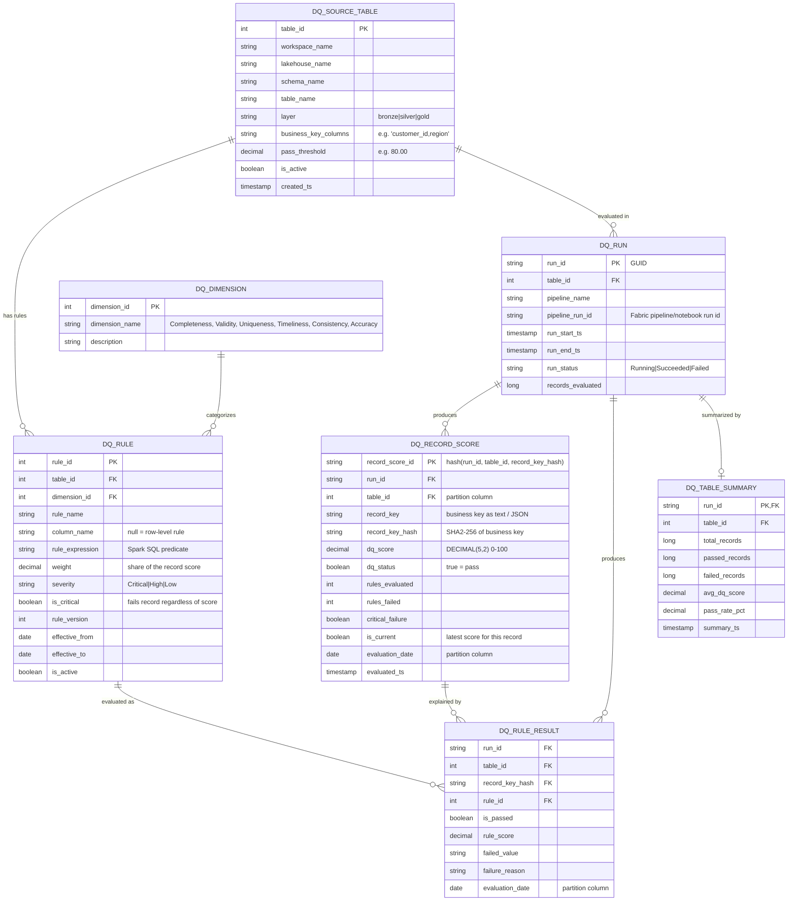

I've designed this as a central DQ store: a few shared tables that hold the score and status for every record from every source table. You don't add DQ columns to each business table, and a new table only needs one row in the table registry plus its rules.

## ERD



## How the tables work

| Table | Role | Grain |
|---|---|---|
| `dq_source_table` | Registry of the tables that get DQ checks. This is what lets one store cover many tables. | One row per source table |
| `dq_dimension` | Reference list of DQ dimensions | One row per dimension |
| `dq_rule` | Rules you configure, with a weight and a version on each | One row per rule version |
| `dq_run` | Audit of each DQ run, linked to the Fabric pipeline run | One row per table per run |
| **`dq_record_score`** | **The core table: DQ Score (decimal) and DQ Status (boolean) for each record** | One row per record per run |
| `dq_rule_result` | Shows which rules a record failed. You can store failures only to keep it small. | One row per record per rule |
| `dq_table_summary` | Totals per run, for Power BI dashboards | One row per run |

## Key design decisions

1. **Generic record key.** Source tables have different primary keys, which may be composite. Store them as `record_key` (text or JSON) plus `record_key_hash`, a SHA2-256 of the business key columns. Joining back to any source table is then always a join on that hash:
   ```sql
   SELECT s.*, d.dq_score, d.dq_status
   FROM silver.customer s
   JOIN dq.dq_record_score d
     ON d.table_id = 12 AND d.is_current
    AND d.record_key_hash = sha2(concat_ws('||', s.customer_id, s.region), 256)
   ```
2. **Score and status logic.**
   - `dq_score` = Σ(weight × pass) / Σ(weight) × 100.
   - `dq_status` = `dq_score >= pass_threshold AND NOT critical_failure`.
3. **History plus a current view.** Each run appends new rows. A `MERGE` then sets `is_current` on the latest row, so you get a trend over time and a quick "current quality" lookup.

## Fabric Lakehouse notes

- **No enforced PK/FK constraints.** Delta tables in a Lakehouse don't enforce primary or foreign keys, so the relationships above are logical only. Check integrity in your notebooks, or declare relationships in the Power BI semantic model.
- **Partitioning.** Partition `dq_record_score` and `dq_rule_result` by `table_id` and `evaluation_date`. Use V-Order, and Z-Order on `record_key_hash`, to speed up joins.
- **Volume control.** `dq_rule_result` grows by records × rules per run. Store failures only, or set a retention period (for example 30–90 days) and run `VACUUM` on a schedule.
- **Placement.** Keep all DQ tables in a dedicated `dq` schema or Lakehouse, separate from the business tables.
- **Optional hybrid.** If your Gold consumers need DQ inline, add `dq_score` and `dq_status` to the Gold tables from the `is_current` rows. Keep the central store as the source of truth.